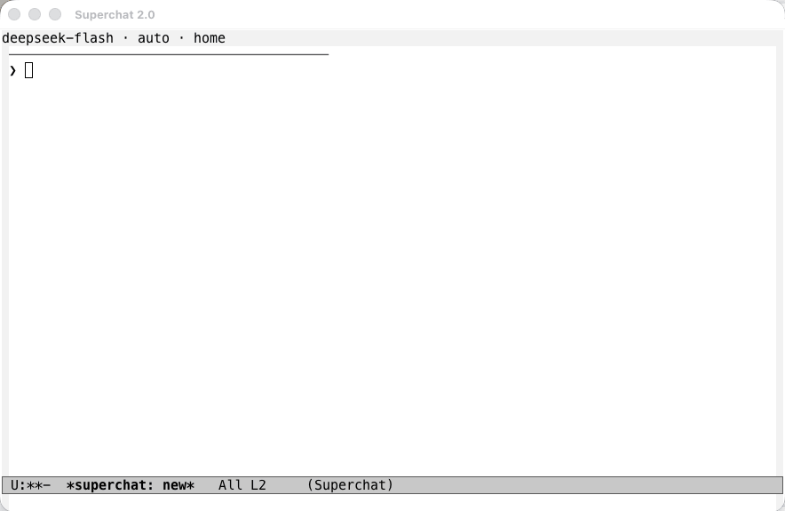

# Superchat

> An Emacs agent that builds on its own experience, turning successful work into reusable skills to expand what it can do.

- **It lives in Emacs.** The agent loop runs in your Emacs process. It reads and edits your buffers, runs Lisp in your session, and looks up any installed package's functions in Emacs's own documentation.
- **It keeps a record.** Every conversation, tool call and result goes on one append-only record, the Tape. Ask next week what was decided today, and it finds it.
- **It grows from what worked.** `/learn` turns the code behind a good answer into a skill with typed tools, so the next time is one call instead of a search.
- **It keeps working.** Timers, an inbox and background runs let it follow up later, ask you only when it must, and notify you.

Ask it to find today's Telega messages about a topic, list the Org headings due this week, or fix a failing test in the buffer you are working on.

[](docs/demo.mp4)

## Why Superchat

Claude Code or Codex can call `emacsclient --eval`, agent-shell runs them in an Emacs buffer, and gptel with gptel-agent brings chat and tools into Emacs. Superchat takes a different approach: its loop runs inside your Emacs, keeps every step on one record, and is built to accumulate capabilities through its own work.

Choose Superchat when you want an agent that does more than use Emacs as an editor: one that builds up a working knowledge of your Emacs and turns experience into reusable capabilities. Choose an external agent through agent-shell when you need its model or tooling, and gptel for a light, provider-rich client you extend yourself. They can live side by side.

## Quick start

Requirements: Emacs 30.1 or later built with SQLite, and `curl`. The model client ships in this repository.

With [elpaca](https://github.com/progfolio/elpaca):

```elisp
(elpaca (superchat :repo "yibie/superchat"
                   :main "superchat.el"
                   :files (:defaults "bridge/lisp/*.el")))

(setq superchat-llm-provider "deepseek"
      superchat-llm-model "deepseek-flash")
```

Put the key in the environment (`DEEPSEEK_API_KEY` for DeepSeek; a missing key's error names the variable), then:

1. `M-x superchat` in a project opens its latest conversation.
2. Ask: "Find where the config is loaded and add a timeout option." It reads files, asks before it edits, runs the tests and answers. Type while it works to redirect it.
3. Ask it to remember: "Note that releases go out on Fridays." Next week, in a new conversation: "When do releases go out?"
4. After it has done a package task well, `/learn telega-` keeps the recipe.

Type `/` in the input to see every command.

To enable timers and nightly reviews, run `M-x superchat-timer-start` once, or add `(superchat-timer-start)` to your init file.

Other providers, a local model, and installing by hand: [docs/reference.md](docs/reference.md#providers).

## What it can do

Superchat is built around a loop that improves with use: it acts in Emacs, records what it does, turns successful work into skills, and uses those skills on later tasks.

```
use Emacs → explore what it can do → record the work that succeeded
          → distill skills → call them next time → take on more
```

### Act in Emacs

The model runs Lisp in your Emacs (`eval_elisp`), reads and edits buffers and files, searches with `grep` and `find`, and runs shell commands.

When it does not know a package, it calls `describe` to look up its API: a prefix lists its functions, a keyword narrows the search, a function name shows its arguments and documentation, and a buffer shows its mode's commands. It looks things up instead of guessing.

### Remember

The **Tape** is one SQLite file that is only ever appended to; a conversation is a view of it. The model searches earlier work with `recall`, keeps conclusions with `note`, and queries the Tape with read-only SQL.

Each answer that relies on tool results names them (`Sources:`), so the record shows what an answer rests on. That record is what skills are drawn from.

With `/dream` on, the model reviews the project's notes each night and replaces those that repeat or are out of date.

### Learn and improve

When the agent works something out, `/learn` keeps it as a recipe for next time.

The first time you ask "Is 2027 a leap year?", the agent does not know how to check that in Emacs. It looks through Emacs's documentation, finds `calendar-leap-year-p`, runs it on 2027 and answers. Then you type `/learn calendar-`, and Superchat writes down what worked as a new tool: give it a year, and it runs `calendar-leap-year-p` on that year. You read the draft and save it.

A week later, in a new conversation, you ask about 2032. The agent skips the search and uses the saved tool:

```text
You    Is 2027 a leap year?
         ✓ describe    calendar leap
         ✓ eval_elisp  (calendar-leap-year-p 2027)
Agent  No.

You    /learn calendar-
         draft: a calendar skill with one tool, leap-year check, takes a year

Later, in another conversation:
You    Is 2032 a leap year?
         ✓ calendar__leap_year_p  :year 2032
Agent  Yes.
```

Only code that ran and that an answer relied on goes into a recipe, word for word; the values that came from your request become what the tool takes. In the draft, `C-c C-c` saves, `C-c C-k` drops, and a form you delete is not proposed again. `/skills review` shows repeated tools and skills whose package has changed.

The result is a growing set of skills: the agent does more without rediscovering the same procedures, and nothing joins that set without your say.

### Continue

The model can set itself a `follow_up` or a `schedule`. Work waits in an inbox that survives Emacs closing, and a background run answers it while Emacs is running; nothing runs while Emacs is closed.

`send` shows you a line, `M-x superchat-messages` lists what was sent and every question waiting for you, and `superchat-inbox-notify-functions` lets you configure system notifications.

## Safety and control

| level | read | write | exec |
|---|---|---|---|
| `read-only` | allowed | refused | refused |
| `ask` (default) | allowed | asks you | asks you |
| `auto` | allowed | allowed | allowed |

When a tool asks for permission, `y` allows it once, `n` refuses, `a` allows that tool for the rest of the conversation. A run nobody watches never blocks Emacs: a call that needs permission becomes a question, and the run waits for you.

Long tasks are kept on track: a failed request is retried where it failed; at 80 model responses the model looks back over its work; a run that goes round in circles is told once to change its approach; and text you send while it runs reaches it before its next step.

## How it works

- **Layers.** L0 base and the model bridge, L1 memory (the Tape), L2 tools and permissions, L3 the agent loop, L4 background work, L5 the interface. Each layer uses only the public functions of those below; gates check it.
- **The Tape** is the single source of truth. Every request is rebuilt from it, which is why a failed request can be retried in place and a run cut off by Emacs closing is marked on the next run.
- **The bridge** is an Emacs Lisp port of part of `@earendil-works/pi-ai`, over `curl`.
- **The contract** is [`SPEC.md`](SPEC.md) and the layer specifications it links; each rule change comes with a decision note under `decisions/`.

## How well it codes

On Aider's polyglot benchmark (225 Exercism exercises in six languages, 2026-11-18), with the same model, `deepseek-flash` at reasoning `high`, under the protocol of Aider's benchmark (tests hidden, a second attempt with the first 50 lines of test output):

| | Superchat | Aider 0.86.2 |
|---|---|---|
| Passed | **193/225 (85.8%)** | 180/225 (80.0%) |
| On the first attempt | 119 | 117 |

Superchat's larger gain comes on the second attempt, where it can run and inspect code with its own tools. The score is strict: 15 exercises where the model went looking for the hidden tests count as failed; without that rule it is 204/225. Per language, Superchat/Aider: Go 35/32, Java 33/28, JavaScript 43/40, Python 31/28, Rust 28/29, C++ 23/23. One run each.

## Reference

- [docs/reference.md](docs/reference.md): keys, commands, tools, options and providers.
- [docs/api.md](docs/api.md): `superchat-run` for other packages, plugins, and typed tools in a skill.
- [docs/faq.md](docs/faq.md): what happens when you hand it a task, what you control, and how it improves.
- [docs/learn.md](docs/learn.md): how a skill grows over three rounds of `/learn`, and the files it keeps.

Common commands: `/new`, `/resume`, `/recall`, `/note`, `/learn`, `/level`, `/model` and `/help`. In any buffer, `M-x superchat-rewrite` changes the region and `M-x superchat-ask` asks about it.

## Limits

- **Two wire formats.** The bridge speaks the OpenAI Chat Completions API and Anthropic's Messages API; OpenAI Responses and Gemini are not supported yet. Anthropic is tested against a stubbed server only, not the real service.
- **No sub-agents.** Conversations run side by side but do not delegate to one another.
- **No MCP**, no images yet.
- **Always-on means while Emacs is open.** Timers missed while it was closed fire once when it starts.

## FAQ

**How is it different from Superchat 1.x?** It is a rewrite: about 6,500 lines plus a built-in model client, against about 125,000; six checked layers in place of many loosely joined parts; and an agent that names its sources and turns cited work into skills. MCP and sub-agents are not in it yet. Moving over, what to type now and a full comparison: [docs/migrating.md](docs/migrating.md).

**Is my data sent anywhere?** Only the requests to the model provider you choose. The Tape, notes and skills stay in `superchat-directory`.

**Can it break things?** At the default level it asks before every edit, write and command. Use `auto` only in projects you trust: then it edits files, runs commands and sets timers without asking.

**Does it work with a local model?** Yes, through any OpenAI-compatible server such as Ollama or LM Studio; see [docs/reference.md](docs/reference.md#providers).

**What is the Tape?** Superchat's memory follows [Tape](https://tape.systems), a data model for context with four parts. A *tape* is the record of what happened, in order. An *entry* is one fact on it, never changed: in Superchat a SQLite trigger refuses updates and deletes, so a correction is a new entry. An *anchor* is a point to rebuild context from: `/handoff` and `/fork` write one, and everything before it stays. A *view* is the context put together for a task: a conversation is the entries from the latest anchor on, and `recall` searches all of them. Each request is built from a view of the Tape, never carried over from the last one.

**What does `/learn` keep, and how does a skill grow?** Beside each `SKILL.md`: `roles.eld`, which values stay holes and which you kept; `evidence.eld`, the results each template ran as; `rejected.eld`, the forms you deleted from a draft. Three rounds of `/learn calendar-`, file by file: [docs/learn.md](docs/learn.md).

**It stopped after many steps. Is that an error?** No. At the round limit it looks back over its work and pauses; send a message to go on.

More questions, on what it can do, how it works, what you control, memory, skills and background work: [docs/faq.md](docs/faq.md).

## Development

```sh
scripts/check.sh          # line caps, gates, compile, tests
scripts/check-bridge.sh   # the bridge
```

Both run in a temporary copy and must print `CHECK OK`. Read [`SPEC.md`](SPEC.md) and [`AGENTS.md`](AGENTS.md) before changing anything.
