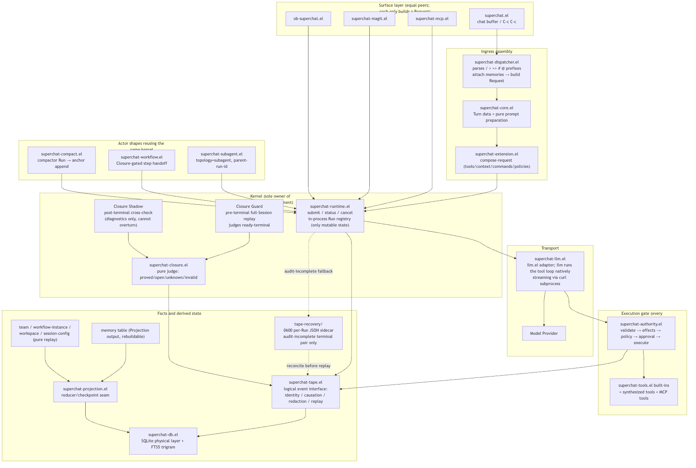
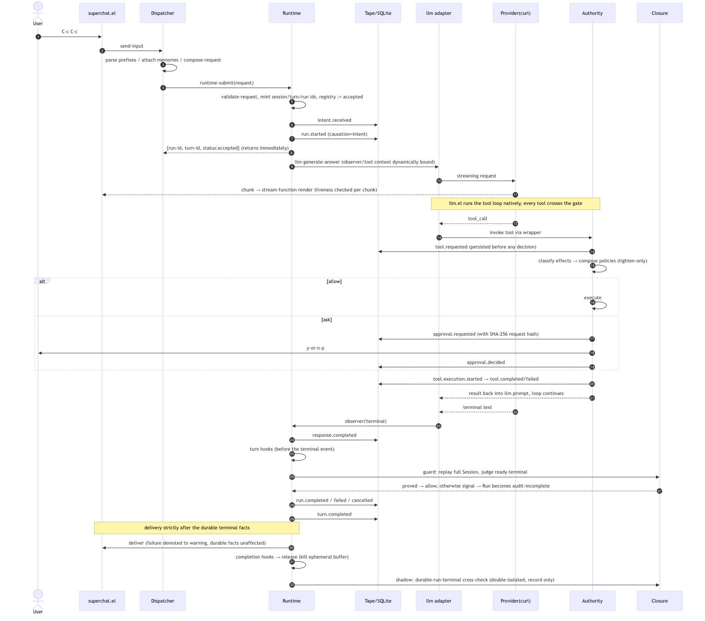
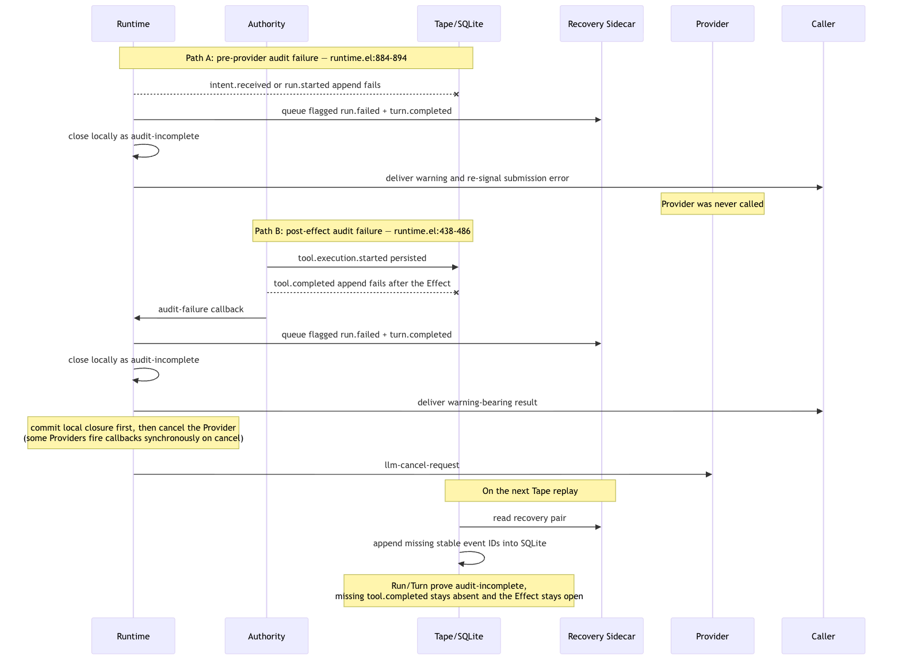

# Runtime Architecture v0

> **Status:** descriptive snapshot of the implementation as of 2026-08-07
> (package v1.3.2).  Every claim below was verified against the code, not
> against earlier documentation.  Diagram sources (`*.mmd`) live in
> `runtime-architecture-v0/`; re-render with
> `mmdc -i <name>.mmd -o <name>.png -b white -s 2`.

## Ownership rules

- **Runtime** (`superchat-runtime.el`) is the sole owner of the
  Request → Turn/Run lifecycle, terminal state, and delivery.  The only
  mutable runtime state is the process-local Run registry.
- **Authority** (`superchat-authority.el`) is the sole execution seam for
  model-invoked tools.
- **Tape** (`superchat-tape.el` over `superchat-db.el`) is the sole durable
  truth interface.  Normal events live in SQLite; only an explicitly flagged
  `audit-incomplete` Run/Turn terminal pair may wait in the protected recovery
  sidecar until Tape replay reconciles it into SQLite.
- **Closure** (`superchat-closure.el`) is the sole judge of what a Tape
  proves.  It stores no state.
- Subagents, Workflows, and the Compactor are ordinary Runtime clients
  (topology `subagent` / `workflow`, or a `compactor` actor), not special
  channels.  `superchat-agent-loop.el` is compatibility/instrumentation
  only; llm.el runs the tool loop natively.

## Layer diagram

## Sequence: one happy-path Turn with one tool call

Terminal order inside `superchat-runtime--finish` (`superchat-runtime.el:495`):

1. `response.completed` (skipped for cancel).
2. Turn hooks — deliberately *before* the terminal event.
3. Closure Guard (`:255`): full-Session replay, `ready-terminal` must judge
   `proved` with the matching terminal kind, otherwise signal
   `superchat-closure-terminal-not-ready`.
4. Run terminal event (`run.completed` / `run.failed` / `run.cancelled`).
5. `turn.completed`.
6. Delivery — strictly after the durable terminal facts; a delivery error
   is demoted to a warning and cannot reopen the Run (`:553-567`).
7. Completion hooks, then release (ephemeral buffer killed).
8. Closure Shadow (`:299`) — last and double-isolated; a bug in it cannot
   fail an already-closed Run.

## Sequence: failure paths

- **Path A — pre-provider audit failure** (`:884-894`): if persisting
  `intent.received` or `run.started` fails, the Provider is not called.
  Runtime queues an explicitly flagged `run.failed` + `turn.completed`
  recovery pair, closes locally as `audit-incomplete`, and re-signals the
  submission error.  On the next Tape replay, the pair is copied into SQLite
  and Closure can prove the exceptional Run/Turn terminal.
- **Path B — post-effect audit failure** (`:438-486`): if a real tool Effect
  occurred but its outcome could not be persisted, Runtime queues the same
  recovery pair, becomes `audit-incomplete`, delivers only a warning-bearing
  result, commits the local lifecycle first, and only then asks the Provider
  to cancel — some Providers invoke callbacks synchronously from cancellation.
  Recovery never adds the missing `tool.completed`; Closure keeps that Effect
  open in the residual boundary.

Both paths are restart-safe when the recovery-sidecar write succeeds.  If the
primary Tape write and the fallback write both fail, Runtime reports the
recovery error but cannot claim a durable terminal.

## Implementation notes (verified 2026-08-07)

- The Guard replays the full Session Tape per terminal event — O(n) per
  Run, noted in-tree (`:259-260` ponytail): add a Run-scoped index only
  after this is measurably too slow.  Default on
  (`superchat-closure-terminal-guard-enabled`); Shadow remains opt-in.
- Cancel skips `response.completed` and goes straight to Guard +
  `run.cancelled` (`:504-510`).
- Streaming chunks re-check Run liveness on every chunk (`:848-856`).
- Every tool call carries a dynamically bound execution context
  (`:791-822`) whose `:audit-failure-function` forces `audit-incomplete`
  and withholds the result.
- `tool.requested` is persisted *before* any Authority decision, so a
  denied or crashed call still leaves an honest trace.
- `superchat-tape-queue-recovery-events` accepts only the flagged
  `audit-incomplete` Run/Turn pair, writes it as a per-Run `0600` JSON sidecar,
  and preserves stable event IDs.  `superchat-tape-replay-events` reconciles
  missing events idempotently before returning the SQLite trace.
- An ordinary open prefix still means only `open`; Closure never infers
  `audit-incomplete` from absence.
